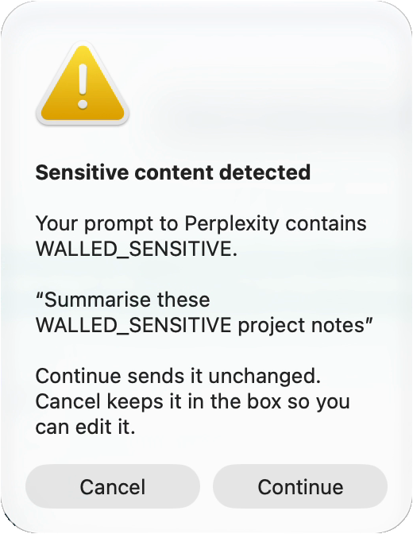
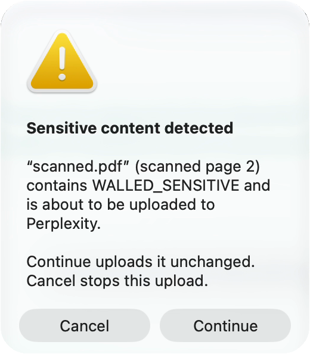

# Sensitive Upload Guard

A small data-loss-prevention tool for **ChatGPT** and **Perplexity** in Google Chrome. Before a prompt or a file that contains the marker `WALLED_SENSITIVE` leaves the browser, a **native macOS dialog** asks whether to go ahead.

- **Demo video:** _link added after upload_
- **How it works:** [docs/ARCHITECTURE.md](docs/ARCHITECTURE.md) · [design doc (PDF)](docs/design-doc.pdf)

<p align="center">
  
  &nbsp;
  
</p>

## What it does

- **Prompts** are checked when you send them: Enter, the Send button, or a form submit. A clean prompt goes through untouched with no delay; the check runs locally in the page. If the marker is there, the send is held and a native dialog shows an excerpt.
- **Files** are checked before they upload: file picker, drag and drop, and pasted files.
  - Text files: UTF-8 or UTF-16.
  - PDFs, including scanned pages, which are read with OCR.
  - Images, read with OCR, plus their metadata.
  - Office documents and zip files.
- **Continue** sends or uploads the content unchanged. **Cancel** blocks it: the prompt stays in the box to edit, and the same file can be picked again.
- **AI responses are recoloured** on both sites, in light and dark themes. The colours are adjustable on the options page.
- **It fails closed.** If the desktop app can't be reached, a prompt with the marker, or any file, is blocked with a short notice. Clean prompts never depend on the app.

```
chatgpt.com / perplexity.ai tab
  └─ content scripts (capture-phase listeners on window, run before the page's own)
       prompt: marker check in the page → only if found: hold → ask the app
       files:  hold → send bytes to the app → clean: replay silently / flagged: dialog
       ↓ chrome.runtime.sendMessage
  service worker  ⇄  native messaging (stdin/stdout)  ⇄  Python desktop app
                                                         inspect: text · PDF · OCR (macOS Vision)
                                                         decide:  native NSAlert (Continue / Cancel)
                                                         audit:   ~/.upload-guard/audit.jsonl (no content)
```

## Requirements

- macOS on Apple Silicon or Intel; built and tested on macOS 27. OCR uses the built-in Vision framework.
- Google Chrome. Chromium, Microsoft Edge and Brave also work: the installer registers the app with each one it finds.
- [uv](https://docs.astral.sh/uv/) and Python 3.10 or newer. I used Python 3.13 from python.org.
- Optional: `tesseract` (`brew install tesseract`), used as a fallback OCR engine.

## Setup

```sh
git clone https://github.com/Ashutoshvashisht007/Sensitive-Upload.git
cd Sensitive-Upload
uv sync
uv run upload-guard install
```

`install` writes a small launcher to `~/.upload-guard/bin/` and registers it with the browsers. It prints the extension ID and the folder to load:

```
Launcher:     /Users/you/.upload-guard/bin/upload-guard-host
Manifest:     /Users/you/Library/Application Support/Google/Chrome/NativeMessagingHosts/com.walled.upload_guard.json  (Chrome)
Extension ID: okhhjehfojbhfinihjkgjjecmapclkan
```

Then load the extension:

1. Open `chrome://extensions` and turn on **Developer mode**.
2. Click **Load unpacked** and choose the `extension` folder of this repo.
3. Pin the shield icon. Its badge turns green **✓** once the extension can reach the desktop app.

You never start the desktop app yourself: Chrome launches it when the extension needs it. The extension ID is fixed by the `key` in `extension/manifest.json`, so it's the same on every machine.

If you move the repo, run `uv run upload-guard install` again, because the launcher points at the project's virtualenv.

## Usage

Use ChatGPT and Perplexity as usual. The `demo/` folder has files to try:

| File | What happens |
|---|---|
| `notes.txt` | Marker on line 5 → dialog |
| `contract.pdf` | Marker on page 2 → dialog |
| `scanned.pdf` | Image-only PDF, marker on scanned page 2 → dialog (via OCR) |
| `whiteboard.png` | Marker written on a whiteboard photo → dialog (via OCR) |
| `clean.pdf`, `clean.png` | No dialog |

For a prompt, type anything containing `WALLED_SENSITIVE` and press Enter.

### Command line

| Command | |
|---|---|
| `uv run upload-guard install` | Register the desktop app with Chrome, Chromium, Edge and Brave. `--browser-dir DIR` adds another `NativeMessagingHosts` folder |
| `uv run upload-guard uninstall` | Remove the launcher and the browser registrations |
| `uv run upload-guard status` | Show what's installed and the last decisions from the audit log |
| `uv run upload-guard scan FILE…` | Check files exactly as uploads are checked. Exit code 0 means clean, 1 flagged or uninspectable, 2 unreadable |
| `uv run upload-guard dialog-test [--kind prompt\|file\|files]` | Show a sample dialog |

### Settings and files

- **Options page** (right-click the shield → Options):
  - response colours for light and dark themes;
  - a switch to turn recolouring off;
  - debug logging to the page console (prefix `[UploadGuard]`; decisions only, never content).
- **`~/.upload-guard/config.json`** (optional):
  - `max_inspect_mb`: default 25;
  - `ocr_max_pages`: default 15;
  - `fail_mode`: `"closed"` by default, which asks about files that can't be inspected; `"open"` lets them through.
- **`~/.upload-guard/`** (mode 0700) holds:
  - the launcher;
  - `host.log`;
  - `audit.jsonl` (0600): one line per flagged prompt or file, with time, site, file name or prompt length, where the marker was, and the decision. **Never the content.**

## Tests

```sh
uv run pytest                       # 114 tests
node --test 'tests/js/*.test.mjs'   # 30 tests
```

- **pytest** covers:
  - the marker rules;
  - every detector on generated fixtures, including OCR and the tesseract fallback;
  - the desktop app as a real process speaking the native-messaging framing;
  - the installer, against a temporary home folder;
  - **33 browser tests**: Playwright's Chromium loads the real extension, the mock pages in `tests/mock_sites` (copies of each site's live markup) are served *as* `chatgpt.com` and `perplexity.ai`, and the real desktop app answers with a scripted dialog.

  The browser tests are skipped if Playwright's Chromium isn't installed (`uv run playwright install chromium`).
- **node:test** runs the extension's marker rules against the same test vectors as Python, so the two can't drift apart.

There are also two macOS checks that briefly show real windows:

```sh
uv run python scripts/check_fullscreen_dialog.py   # dialog appears over a full-screen app, same display, with focus
uv run python scripts/check_dialog_closes.py       # dialog really closes after it's answered
```

Test fixtures and the demo files are generated by `uv run python scripts/make_fixtures.py`.

## Troubleshooting

- **Red `!` on the shield.** Run `uv run upload-guard status`. Every line should say `ok`. If not, run `install` again, then reload the extension in `chrome://extensions`. `~/.upload-guard/host.log` has the details.
- **"Sensitive Upload Guard was updated, reload this page".** The extension was reloaded while the tab was open. Reload the tab.
- **Something isn't caught after a site update.** Turn on debug logging in Options and watch the console for `[UploadGuard]` lines. The selectors are in `extension/content/sites/chatgpt.js` and `perplexity.js`. To see the site's current markup, run the snippet below in DevTools on the site. It copies attributes only, never message text. If Chrome blocks pasting into the console, type `allow pasting` first.

  ```js
  (() => {
    const pick = el => el && ({tag: el.tagName.toLowerCase(), id: el.id || undefined,
      testid: el.getAttribute('data-testid') || undefined, aria: el.getAttribute('aria-label') || undefined,
      role: el.getAttribute('role') || undefined, ce: el.getAttribute('contenteditable') || undefined,
      cls: (el.className && String(el.className).slice(0, 120)) || undefined});
    const out = {
      editors: [...document.querySelectorAll('textarea,[contenteditable="true"]')].map(pick),
      buttons: [...document.querySelectorAll('button')].filter(b => /send|submit|attach|upload|file/i
        .test((b.getAttribute('aria-label') || '') + (b.getAttribute('data-testid') || ''))).map(pick),
      fileInputs: [...document.querySelectorAll('input[type=file]')].map(pick),
    };
    copy(JSON.stringify(out, null, 2)); console.log(out);
  })();
  ```

## Limitations

- **Browsers.** Only Chrome-family browsers with the extension installed are covered: Chrome, Chromium, Edge and Brave. Firefox and Safari would need ports.
- **Platforms.** macOS is built and tested. The Linux (zenity) and Windows (MessageBox) dialogs exist but are untested, and Windows also needs registry-based host registration, which the installer doesn't do yet.
- **Site changes.** Both sites change their markup often; both had changed before I finished this. Selectors live in two small adapter files with fallbacks and debug logging. A network-level backstop would be the next step: hooking `fetch`/XHR in the page for the known upload and conversation endpoints.
- **Upload paths not covered:**
  - the File System Access API (`showOpenFilePicker`);
  - file inputs inside a shadow DOM;
  - dropped folders;
  - prompts sent by voice.

  Neither site uses these for normal uploads today.
- **OCR.** It can miss tiny, stylised or handwritten text. In OCR'd text the match is tolerant, so it can occasionally flag the two words "walled sensitive" in an image. Images and scans that can't be read ask the user instead of passing silently. Only the first frame of an animated GIF or multi-page TIFF is read.
- **Large files.** Files over 25 MB (and anything past 40 MB in one batch) aren't inspected; the user is asked instead. PDF OCR stops after 15 pages, and then the user is asked too.
- **Not a hard boundary.** It guards against mistakes, not a determined user: anyone can disable the extension. A managed deployment would force-install it through Chrome policy.

## Layout

```
src/upload_guard/
  native_host.py      native messaging host: framing, reader thread, main-thread dialog queue
  protocol.py         message framing and shapes
  detect/             marker rules (marker.py), file type sniffing, text / pdf / image / zip detectors, OCR
  dialog/             NSAlert (macOS), osascript fallback, zenity, MessageBox, test backends
  install.py, cli.py  installer and the upload-guard command
  audit.py, config.py
extension/
  manifest.json, background.js, options.html/.js
  content/page-hook.js        page-world hook for detached file inputs
  content/marker.js           JS port of marker.py
  content/sites/*.js          per-site selectors
  content/engine.js           interception, hold, replay, notices
  content/response-color.js   response recolouring
tests/                pytest, node:test, mock sites, browser tests, shared marker vectors
scripts/              fixture and icon generators, macOS dialog checks
demo/                 files used in the demo
docs/                 ARCHITECTURE.md, design-doc.pdf
```
