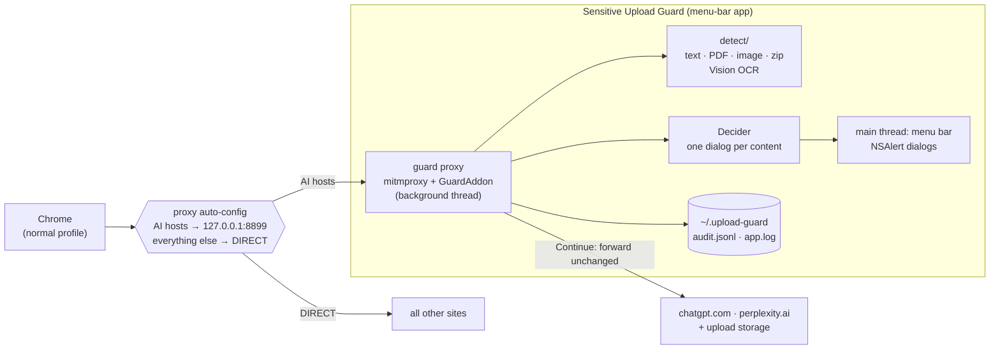

# Architecture

How Sensitive Upload Guard intercepts prompts and uploads to ChatGPT and Perplexity, and how it enforces the user's decision. The short version is in the [README](../README.md); a printable version with diagrams is in [design-doc.pdf](design-doc.pdf).

## 1. The constraint that shaped it

The brief asks for a standalone desktop application that watches ChatGPT and Perplexity *in a normal browser*. It must inspect prompts and files **before they're sent**, ask with a **native** dialog, and recolour AI answers. A browser extension isn't allowed, even as a helper.

So the app has to see the traffic from outside the browser. It does that the way endpoint DLP products usually do: a **local proxy** that the system routes the AI sites through. Because the app is the endpoint that decrypts those connections, it can read each request in full and decide whether to forward it.

## 2. Components



| Part | Role | Code |
|---|---|---|
| Menu-bar app | Runs at login. AppKit on the main thread (menu, dialogs); the guard on a background asyncio loop | `app.py` |
| Guard proxy | mitmproxy as a library, listening on `127.0.0.1:8899`. Decrypts only the routed hosts | `proxy/server.py` |
| GuardAddon | Classifies each request, inspects it, gets a decision, then forwards or blocks it. Recolours pages on the way back | `proxy/addon.py` |
| Site rules | Hosts, send and upload endpoints, and answer selectors for each site. The only site-specific file | `sites.py` |
| Detection | Marker rules, file type sniffing, per-format detectors, OCR | `detect/` |
| Decider | Turns "should this go?" into at most one dialog per piece of content, on the right thread | `decisions.py` |
| Dialog | NSAlert with the full-screen fixes; osascript fallback; test backends | `dialog/` |
| Installer | Local CA and its trust, proxy auto-config, login item; `uninstall` reverses them | `install.py`, `cli.py` |

## 3. Getting the traffic: routing and decryption

**Routing.** `install` sets a **proxy auto-config (PAC)** on every macOS network service. It goes in as a `data:` URL, so it never depends on a server being up:

```js
function FindProxyForURL(url, host) {
  var h = host.toLowerCase();
  if (h == "chatgpt.com" || dnsDomainIs(h, ".chatgpt.com") || h == "chat.openai.com" ||
      dnsDomainIs(h, ".oaiusercontent.com") || h == "perplexity.ai" || dnsDomainIs(h, ".perplexity.ai") ||
      h == "ppl-ai-file-upload.s3.amazonaws.com" || …)
    return "PROXY 127.0.0.1:8899";
  return "DIRECT";
}
```

- **Only the AI sites go through the app.** Everything else is `DIRECT`, so normal browsing never touches it.
- **No fallback for the AI hosts.** If the app isn't running, those sites don't load (fail closed) while the rest of the web works.
- **Who follows it.** Chrome, Edge, Brave and Safari all read the macOS proxy settings, so nothing has to be installed in the browser.
- **Previous settings.** They're backed up to `~/.upload-guard/proxy-backup.json` and restored by `uninstall`.

**Decryption.** On first run the app creates its own certificate authority with mitmproxy's `create_ca`, named "Sensitive Upload Guard local CA". `install` trusts it in the user's login keychain.

- When Chrome connects to `chatgpt.com` through the proxy, the app presents a certificate for `chatgpt.com` signed by that CA, then opens its own verified TLS connection to the real site.
- `allow_hosts` limits decryption to the routed AI hosts. Anything else that reaches the port is tunnelled untouched.
- HTTP/3 is off for these hosts, because a proxied connection uses HTTP/1.1 or HTTP/2 over TCP.
- The CA's private key is created on the Mac and stays in `~/.upload-guard/ca/` (mode 0700).

I checked that this doesn't upset the sites' bot protection. A fresh Chromium loaded the public pages of chatgpt.com and www.perplexity.ai both directly and through the guard: same status and title, the composer present, no challenge, and no page errors.

## 4. Holding and deciding (GuardAddon)

mitmproxy hands every request on a routed host to the add-on **before** anything is sent upstream. The hooks are `async`, so a request can wait for the user while other traffic keeps flowing.

| Hook | What happens |
|---|---|
| `requestheaders` | Attribute the request to a site: by host, or for storage hosts by `Origin`/`Referer`. If an upload is larger than the inspection limit, ask straight away ("couldn't be inspected"). If the user continues, stream it without buffering |
| `request` | The body is complete. Classify it, inspect it, decide (below) |
| `websocket_message` | Client messages carrying the marker are held the same way; Cancel drops the message |
| `response` | Upload set-up replies teach which storage URL belongs to which file name. HTML pages get the colour style |

**How a request is classified:**

1. **Upload.** Multipart parts with a filename, or a PUT/POST of raw bytes to an upload host. Each file goes through the detectors on a worker thread, so OCR never stalls the proxy. The file name comes from the multipart part, from the earlier set-up request (ChatGPT announces `file_name` and gets back an `upload_url`), or from the URL.
2. **Send.** The path matches the site's send rules, or it's any POST/PUT/PATCH whose text (JSON values, form fields, plain text) contains the marker. Result: a prompt dialog with an excerpt.
3. **Background.** A GET whose URL carries the marker, such as typeahead suggestions sent while the user types. It's blocked without a dialog: the marker never leaves, and the user isn't interrupted mid-sentence.
4. **Quiet.** Telemetry and analytics: `/ces/…` and `ab.chatgpt.com` on ChatGPT, `/rest/event/analytics` and `count.perplexity.ai` on Perplexity, plus generic telemetry-looking paths. In the live test both sites copied the typed prompt into these. Carrying the marker, they're blocked without a dialog, unless the user already chose Continue for that exact text.
5. **Clean.** Forwarded untouched.

**Decisions.** The Decider keys each decision on the content: the prompt text, or the file bytes (sha256).

- **Parallel duplicates.** The same content arriving in parallel requests (ChatGPT sometimes sends a "prepare" and a "conversation" request) waits on one dialog.
- **Continue** is remembered for 10 minutes, so retries pass without asking again.
- **Cancel** is remembered for 1.5 s, only to swallow parallel duplicates. A deliberate resend gets a fresh dialog.
- **One at a time.** Dialogs are serialised on the AppKit main thread.

**Enforcement:**
- **Continue:** the add-on returns without touching the flow, and mitmproxy forwards the original bytes.
- **Cancel:** the add-on sets `flow.response` to a local `403`, so the request is never sent upstream. The body is `{"detail": "Blocked by Sensitive Upload Guard. Nothing was sent."}`, plus CORS headers for the page's origin, so the site's own error handling can show it. ChatGPT does, with a Retry button; Perplexity shows its generic "Something went wrong while generating this response." The message deliberately doesn't contain the marker, because sites echo error messages into their telemetry, which would trigger a second dialog. Every decision is written to the audit log, without content.

## 5. Recolouring answers

When a routed site returns an HTML page (`GET`, `200`, `text/html`, `Sec-Fetch-Dest: document`), the add-on inserts one `<style>` before `</head>`. Its selectors come from `sites.py`:

- **ChatGPT:** `[data-markdown-text-style="assistant-message"]`, `[data-response-body]`.
- **Perplexity:** `.prose`.

The colours are teal: `#0f766e` in light themes and `#5eead4` in dark, following `<html data-theme>` (ChatGPT), `data-color-scheme` (Perplexity) or the system setting. Because the rule matches the answer containers, text that streams in later is coloured too.

**Caching.** Page requests to the two sites have their `If-None-Match`/`If-Modified-Since` headers removed, and coloured pages lose their `ETag`/`Last-Modified`. Otherwise a cached copy from before the app was installed could come back as `304 Not Modified` and be shown without the style. The live test showed this on Perplexity, whose pages are cacheable.

**CSP.** If the page's Content-Security-Policy would block an inline `<style>`, the style gets a fresh nonce, and only a `style-src-elem` directive is added or extended. Nothing else in the policy changes. A policy that already allows inline styles with `'unsafe-inline'` is left alone, because adding a nonce there would switch `'unsafe-inline'` off for the site's own styles.

## 6. Detection

Unchanged from the first version, and shared with the `scan` command.

- **Exact rules** for prompts, text and metadata: NFKC-normalise, drop zero-width characters and soft hyphens, then match `WALLED_SENSITIVE` case-insensitively.
- **OCR-tolerant rules** for text read from images and scans: also accept `1 l | !` for I and L, `5 $` for S, `VV` for W, a stray character between letters, and a space where the underscore was.

| Type | How it's checked | `where` reported |
|---|---|---|
| Text | Decode by BOM (UTF-8/16), else UTF-8; plus a raw-bytes scan (ASCII, UTF-16) | `line N` |
| PDF | `pypdf` text per page and metadata, `pypdfium2` fallback. Pages with little text or with images are rendered and OCR'd, up to 15 | `page N`, `scanned page N` |
| Image | PNG text chunks, EXIF and XMP, then OCR (retried enlarged for small images) | `text in the image`, `image metadata` |
| ZIP / Office | XML parts with tags stripped (Word splits words across runs); other entries recursed; zip-bomb limits | `document text`, `slide N`, … |

OCR uses **macOS Vision**: on-device, with language correction off so the marker isn't "corrected". `tesseract` is the fallback.

Files that can't be inspected are never passed silently. That covers:
- files too large to inspect;
- password-protected files;
- damaged files;
- no OCR engine available;
- parser errors.

They get a dialog that says why, unless `fail_mode` is `"open"`.

## 7. The native dialog

```
⚠  Sensitive content detected
   “contract.pdf” (page 2) contains WALLED_SENSITIVE and is about to be uploaded to Perplexity.
   Continue uploads it unchanged. Cancel stops this upload.
                                                     [ Cancel ]  [ Continue ]
```

- **Cancel is the default button:** Return and Esc both choose it.
- **Prompt dialogs** quote about 40 characters either side of the marker.

Getting it over **full-screen Chrome** took four fixes:

1. **Agent app.** The app is an accessory app (no Dock icon), which lets its windows join other Spaces.
2. **Level and Space behaviour.** The alert window gets `CanJoinAllSpaces | FullScreenAuxiliary` and status-bar level 25. `runModal` quietly lowers the level, so a timer in the modal run loop restores it once the alert is up.
3. **Right display.** The alert is centred on the display showing the browser's front window, or else the display under the mouse.
4. **Close cleanly.** After the answer, the window is ordered out and the event loop runs briefly, so the alert never lingers on screen; then focus returns to Chrome.

`scripts/check_fullscreen_dialog.py` verifies this without screen recording, using `CGWindowList` and `NSWorkspace`. It checks that the dialog is on top of a native full-screen window, on the same display, at level 25, with keyboard focus. `scripts/check_dialog_closes.py` checks that nothing is left on screen after an answer.

**The app loop.** In the app, dialogs run on the AppKit main thread through `MainThreadRunner` (`AppHelper.callAfter`), while the proxy's asyncio loop waits on a future. I checked this path in-process: a real NSAlert appeared and was cancelled by a timer, and the request came back as `403` within a second, without leaving the Mac.

## 8. Install, run, uninstall

| Step | `install` | `uninstall` |
|---|---|---|
| Certificate | Create the CA; `security add-trusted-cert -r trustRoot -p ssl -k login.keychain` (macOS asks for the password) | Remove the trust setting and delete the certificate |
| Proxy auto-config | Back up each service's current PAC; `networksetup -setautoproxyurl` with the data URL. If macOS wants an admin, one `osascript … with administrator privileges` covers every service | Restore the backup |
| Login item | `~/Library/LaunchAgents/com.walled.upload-guard.plist`: `RunAtLoad`, and `KeepAlive` only after a crash, so Quit really quits | `launchctl bootout`, delete the file |

## 9. Failure modes

| Situation | Behaviour |
|---|---|
| App not running | ChatGPT and Perplexity don't load (no fallback in the PAC); everything else works |
| App crashes | launchd restarts it; until then, as above |
| File can't be inspected | Dialog explains why and asks |
| Dialog can't be shown | Treated as Cancel |
| Upload goes to a host that isn't routed | The set-up reply reveals it; the app logs a warning naming the host to add to `sites.py` |
| Same prompt in parallel requests | One dialog; the answer applies to all of them |
| Typeahead carrying the marker | Blocked silently; the actual send gets the dialog |

## 10. Security and privacy

- **Local only.** Everything is inspected on the Mac, and Vision OCR is on-device. Allowed content goes only to the site the user chose.
- **Narrow decryption.** Only the AI hosts are decrypted. The CA key is generated locally and stored with owner-only permissions. `uninstall` removes the trust.
- **No content in logs.** The audit log and the optional request log hold metadata only: time, site, file name or prompt length, where, decision, and for requests method, host, path and size.
- **Not a hard boundary.** It's a guardrail against mistakes. A determined user can uninstall it or change the proxy settings. A managed deployment would push the PAC and the CA with a configuration profile and lock them.

## 11. How it's tested

160 tests, all run by `uv run pytest`:

- **End to end (21).** Chromium starts with only the app's PAC data URL. It goes through the real guard to a local stand-in for both sites, which records what arrives, so "blocked before it was sent" is checked directly. The mock pages copy each site's markup and network calls:
  - ChatGPT: `POST /backend-api/files`, then `PUT` to `files.oaiusercontent.com`;
  - Perplexity: `create_upload_url`, then a multipart `POST` to the S3 bucket; typeahead `GET`s.

  The ChatGPT mock also sends a nonce-based CSP.
- **Add-on (29)** on mitmproxy flows, including telemetry copies of a prompt, ChatGPT's live upload flow and automatic retries.
- **Units (37):** sites, bodies, CSP, PAC routing evaluated in Node, the Decider.
- **Installer (8),** with `networksetup`, `security` and `launchctl` mocked.
- **Detectors (33)** and **marker rules (30)** on generated fixtures.
- **Dialog (2).**
