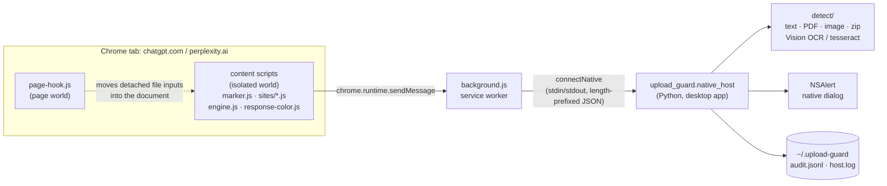

# Architecture

How Sensitive Upload Guard intercepts prompts and uploads on ChatGPT and Perplexity, and how it enforces the user's decision. The short version is in the [README](../README.md); a printable version with diagrams is in [design-doc.pdf](design-doc.pdf).

## 1. Components



| Part | Role | Code |
|---|---|---|
| Content scripts | **Sensor and enforcer.** Catch Send and uploads before the page sees them, hold them, replay or drop them. Recolour responses. | `extension/content/` |
| Site adapters | Selectors only: composer, send button, response containers. One small file per site. | `extension/content/sites/` |
| Service worker | Bridge to the desktop app. One native port, request ids, badge. | `extension/background.js` |
| Native host | **Inspector and decision-maker.** Inspects files, re-checks prompts, shows the native dialog, writes the audit log. Chrome starts it on demand. | `src/upload_guard/native_host.py` |
| Detection | Marker rules, file type sniffing, per-format detectors, OCR. | `src/upload_guard/detect/` |
| Dialog | NSAlert (with the full-screen fix), osascript fallback, test backends. | `src/upload_guard/dialog/` |
| Installer / CLI | Registers the host with Chrome, Chromium, Edge and Brave; `scan`, `status`, `dialog-test`. | `src/upload_guard/install.py`, `cli.py` |

## 2. Why this split

The browser is the only place that sees a prompt or file *before* it is sent, with enough context to stop it cleanly. The brief also requires a native dialog, which a browser extension can't show. So the extension holds the action and the desktop app decides.

Approaches I ruled out:

- **HTTPS proxy (MITM).** Needs a trusted root CA on the machine. Blocking at the network level leaves the web app half-sent, showing an error and with no clean way to retry. Uploads are often already chunked by the time they hit the wire.
- **Driving Chrome over its debugging port.** Needs a special profile and leaves a debug port open, which is a security problem of its own. It also isn't "a normal browser".
- **Embedded browser.** Not a normal browser either, and Google sign-in blocks embedded web views.

## 3. Interception (extension)

### 3.1 Getting there first

All content scripts run at `document_start`. `engine.js` registers capture-phase listeners **on `window`** for `keydown`, `click`, `submit`, `input`, `change`, `drop` and `paste`. An event's capture phase starts at `window`, so these listeners run before anything the page registers further down the path. That includes React's root listeners and the editors' own handlers (ProseMirror on ChatGPT, Lexical on Perplexity). The page can't register on `window` earlier than a `document_start` script.

To stop an action, the engine calls `preventDefault()` and `stopImmediatePropagation()`. The page never sees the event, so its state stays as it was. To let a held action through later, the engine **replays** it:

```js
let bypass = 0;
function replay(fn) { bypass++; try { fn(); } finally { bypass--; } }
```

Every handler returns early while `bypass > 0`. `element.click()` and `dispatchEvent()` run listeners synchronously, so the counter covers exactly the replayed event and nothing else.

### 3.2 Prompts

| Trigger | Detected by |
|---|---|
| Enter (not Shift+Enter, not during IME composition; Cmd/Ctrl+Enter counts) | `keydown` whose target is inside a composer selector |
| Send button | `click` on an adapter send button, or a button labelled `Send…`/`Submit…` near a composer |
| Form submit | `submit` on a form containing a composer |

1. Read the composer text (`value` for textareas, `innerText` for contenteditable).
2. Run the marker check **locally** (`marker.js`). This is synchronous and takes microseconds. Clean prompts are not held at all and never touch the desktop app.
3. Marker found: hold the event and send `{type: "prompt", text}` to the desktop app. It re-checks the text with the Python rules and shows the dialog. Any further Enter or click on that composer is swallowed until the answer arrives.
4. **Continue:** if the text is unchanged, replay the send by clicking the same button, or the send button next to the composer, or `requestSubmit()`. Failing all those, dispatch an Enter keydown. The approved text is allowed through for 5 seconds, so an app that resubmits a moment later isn't asked twice.
5. **Cancel:** nothing is sent. The text stays in the box and focus goes back to it. A small in-page notice says "Blocked by Sensitive Upload Guard".

### 3.3 Files

| Path | Hold | Replay on Continue |
|---|---|---|
| File picker (`<input type=file>`) | Stop `input` and `change` at `window`, remember which fired | Dispatch the same events again on the same input |
| Drag and drop | `preventDefault` + stop the `drop`; copy `dataTransfer.files` immediately (the DataTransfer is locked after the event) | Dispatch a new `DragEvent('drop')` with a rebuilt `DataTransfer` at the same target and coordinates |
| Paste with files | Stop the `paste`; copy files and any text/HTML types | Dispatch a new `ClipboardEvent('paste')` with a rebuilt `DataTransfer` |

Files are always held briefly, because only the desktop app can inspect them. The engine reads each file with `file.arrayBuffer()`, base64-encodes it in chunks, and sends one `files` request for the batch.

- **All allowed:** replay as above.
- **Some cancelled** (several files in one action): rebuild a `DataTransfer` with the allowed files only, set `input.files`, then replay. The dialog says the other files will still upload.
- **All cancelled:** don't replay. For the picker, reset `input.value = ""` so choosing the same file again fires `change` again. For a drop, dispatch `dragleave` so the app's drop overlay goes away.

Some upload libraries call `click()` on an `<input type=file>` that was never added to the document. That input's events never reach `window`. `page-hook.js` runs in the page's own world and wraps `HTMLInputElement.prototype.click` and `showPicker`. Just before such an input opens the picker, it moves the input into a hidden holder in the document, so its events bubble like any other. The page keeps its own reference and handlers. As an extra layer, a `MutationObserver` adds direct listeners to every file input that appears.

### 3.4 Site adapters

`extension/content/sites/chatgpt.js` and `perplexity.js` hold **selectors only**. Each list is tried in order, and the engine does the rest:

- `composers`: the main ask box. Plus `editComposers` for editing an earlier message on ChatGPT.
- `sendButtons`: the send button, with a generic "button labelled Send/Submit in the same form" fallback.
- `responses`: containers of AI answers, with user messages excluded.

The selectors were checked against the live sites in November 2026 with a recon snippet that reads attributes only (see README). Both sites had changed since my first guesses:
- **ChatGPT:** no more `#prompt-textarea` or `data-message-author-role`. The composer is `[data-composer-input] [contenteditable]`, Send is `button[type=submit][aria-label=Send]`, and answers are `[data-markdown-text-style="assistant-message"]`.
- **Perplexity:** no more `#ask-input`; answers are `div.prose`.

That drift is why selectors live in two small files, with fallbacks and debug logging.

### 3.5 Response colour

`response-color.js` injects one `<style>` built from the adapter's `responses` selectors:

```css
:root { --upload-guard-response: #0f766e; }                         /* light */
:root[data-theme="dark"], :root[data-color-scheme="dark"], :root.dark { --upload-guard-response: #5eead4; }
@media (prefers-color-scheme: dark) { :root:not(.light):not([data-theme="light"]):not([data-color-scheme="light"]) { … } }
SEL, SEL * { color: var(--upload-guard-response) !important; -webkit-text-fill-color: … }
```

The rule matches containers, not individual text nodes, so text recolours while it streams in. ChatGPT sets the theme on `<html data-theme>` and Perplexity on `<html data-color-scheme>`, and both are handled. If the page replaces `<head>` or drops the element, a small `MutationObserver` puts it back. Colours and an on/off switch are on the options page (`chrome.storage.sync`).

## 4. Enforcement (desktop app)

### 4.1 Native messaging

- **Host name** `com.walled.upload_guard`. `upload-guard install` writes:
  - a launcher, `~/.upload-guard/bin/upload-guard-host`, which runs `exec <venv>/python -I -m upload_guard.native_host`;
  - a host manifest in each installed browser's `NativeMessagingHosts` folder. Its `allowed_origins` contains only this extension's ID.
- **Fixed extension ID.** The ID is fixed by the public `key` in `extension/manifest.json`. The installer derives the ID from that key, so it's written down in one place only.
- **Framing.** Each message is a 4-byte native-endian length followed by UTF-8 JSON, in both directions.
- **stdout** carries protocol frames only. The host keeps a private copy of fd 1 and points fd 1 at stderr, so a stray `print` can't corrupt the stream. Logs go to `~/.upload-guard/host.log`.
- **Service worker.** It keeps one port and opens it on first use; an open port also keeps the worker alive. Each request carries an id. If the port drops, every waiting request is answered with `{error: "host_unavailable"}`. The toolbar badge shows ✓ (green) after a successful ping and ! (red) when the host can't be reached.

| Request | Reply |
|---|---|
| `{id, type: "ping"}` | `{id, ok: true, version, max_inspect_mb}` |
| `{id, type: "prompt", site, text}` | `{id, decision: "continue" \| "cancel", found}` |
| `{id, type: "files", site, files: [{name, mime, size, b64 \| null, skipped?}]}` | `{id, decision, dialog, results: [{index, name, found, uninspectable, where, decision}]}` |
| anything else, or a failure | `{id, error}` |

### 4.2 Threads

A reader thread parses frames and answers `ping` straight away. Everything else goes onto a queue that the **main thread** works through one request at a time, because AppKit dialogs must run on the main thread. As a result, dialogs are naturally queued: if a second request arrives while one dialog is open, it waits its turn. When the browser closes the pipe, the host exits. Chrome starts it again on the next request.

### 4.3 Detection

The marker rules live in `detect/marker.py` and its line-for-line port `extension/content/marker.js`. Both are tested against the same vectors (`tests/vectors/marker_cases.json`), so they can't drift apart.

- **Exact mode** (prompts, text, metadata): normalise with NFKC, strip zero-width and soft-hyphen characters, then match `WALLED_SENSITIVE` case-insensitively. This catches fullwidth letters and `WALL​ED_SEN‍SITIVE` with hidden characters.
- **OCR mode** (text from images and scans) also accepts the usual OCR confusions:
  - `1`, `l`, `|` and `!` for I and L;
  - `5` and `$` for S;
  - `VV` for W;
  - a stray character between letters, and a space or nothing where the underscore was.

Files are typed by magic bytes first (`%PDF`, PNG, JPEG, GIF, WebP, HEIC, TIFF, BMP, ZIP), then by extension and MIME:

| Type | How it's checked | `where` reported |
|---|---|---|
| Text | Decode by BOM (UTF-8/16), else UTF-8; plus a raw-bytes scan (ASCII, UTF-16 LE/BE) | `line N` |
| PDF | `pypdf` text per page and metadata (empty password tried); `pypdfium2` fallback if pypdf fails. Pages with under 20 characters or with images are rendered (2×) and OCR'd, up to 15 pages | `page N`, `scanned page N` |
| Image | PNG text chunks, EXIF and XMP; then OCR, retried on a 2–3× enlarged copy for small images | `text in the image`, `image metadata` |
| ZIP / Office | Up to 500 entries / 200 MB unpacked. XML parts are checked with tags stripped, because Word splits text into runs. Other entries go through the detectors above, so a picture inside a .docx is OCR'd | `document text`, `slide N`, `entry (…)` |
| Other binary | Raw-bytes scan | `file contents` |

OCR uses the **macOS Vision** framework first: on-device, accurate, with language correction turned off so `WALLED_SENSITIVE` isn't "corrected". It falls back to `tesseract`. The host warms Vision up in a background thread at start-up, so the first upload doesn't pay the model-loading cost.

**If in doubt, ask.** A file that can't be inspected comes back as *uninspectable* rather than clean, and the user gets the dialog with the reason. That covers:
- files over 25 MB;
- password-protected PDFs and archives;
- damaged files;
- no working OCR engine;
- scanned pages beyond the OCR limit;
- any parser crash.

### 4.4 The native dialog

```
⚠  Sensitive content detected
   “contract.pdf” (page 2) contains WALLED_SENSITIVE and is about to be uploaded to Perplexity.
   Continue uploads it unchanged. Cancel stops this upload.
                                                     [ Cancel ]  [ Continue ]
```

- **Cancel** is the first button, which makes it the default: Return and Esc both choose it.
- **Prompt dialogs** show an excerpt: about 40 characters either side of the marker.
- **Several files:** one dialog lists every flagged file and says how many clean files will still upload.

Showing a dialog over **full-screen Chrome** took four fixes:

1. **Agent app.** The host runs as an accessory app (`setActivationPolicy_(1)`), so it has no Dock icon and is allowed into other Spaces.
2. **Space behaviour and level.** The alert window gets `CanJoinAllSpaces | FullScreenAuxiliary` and status-bar level 25. `runModal` quietly resets the level to the modal-panel level (8), so a timer in the modal run loop sets it back, along with `orderFrontRegardless` and `makeKeyWindow`, once the alert is up.
3. **Placement.** The alert is centred on the display showing Chrome's front window: Chrome is the host's parent process, so the host can find it in `CGWindowList`. Without this, on a two-display setup it opened on the other screen.
4. **Closing.** After `runModal` returns, the host orders the window out and runs the event loop for 150 ms. Without that the alert stayed frozen on screen, because the host goes straight back to blocking on its queue. Focus then goes back to Chrome.

Two scripts verify this without screen recording, using `CGWindowList` and `NSWorkspace`:
- `scripts/check_fullscreen_dialog.py` puts a Tk window into native full screen, then shows the dialog. It checks that the dialog is on screen on the same display at level 25 with keyboard focus, and that the full-screen window never left the screen.
- `scripts/check_dialog_closes.py` answers a real dialog and checks that no window is left behind.

If PyObjC isn't available, the dialog falls back to `osascript`. The text is passed as `argv` to `on run argv`, never spliced into the script source, so a file name can't inject AppleScript.

### 4.5 Audit log and settings

- **Directory:** `~/.upload-guard/` is created with mode 0700.
- **`audit.jsonl`** (0600) gets one line per flagged prompt or file: `ts, site, kind, name, where, decision, reason`. `name` is the file name, or `prompt (N chars)` for prompts. **No prompt text or file content is ever written.**
- **`config.json`** is optional. It sets `max_inspect_mb` (25), `ocr_max_pages` (15) and `fail_mode`. `fail_mode` is `"closed"` by default; with `"open"`, files that can't be inspected pass without a dialog.

## 5. Failure modes

| Situation | Behaviour |
|---|---|
| Clean prompt, app not running | Sent normally (the local check doesn't need the app) |
| Prompt with marker, app not running | Blocked; notice: "Sensitive Upload Guard app isn't running, blocked" |
| Any file, app not running | Blocked (it can't be inspected) with the same notice |
| Extension reloaded under an open tab | Blocked; notice asks to reload the page |
| File can't be inspected (size, password, damage, OCR unavailable) | Dialog explains why and asks |
| Host crashes mid-request | Port drops → waiting requests get `host_unavailable` → blocked |
| User edits the prompt while the dialog is open, then clicks Continue | Not sent; pressing Enter again re-checks the new text |
| Two actions at once | Requests queue; one dialog at a time |
| NSAlert fails | Falls back to the `osascript` dialog |

## 6. Security and privacy

- **Local only.** Everything is inspected on the machine. Vision OCR runs on-device, and nothing is sent anywhere except to the site the user chose, and only if allowed.
- **Who can talk to the host.** Only this extension can start it, because `allowed_origins` contains its fixed ID. The launcher runs Python with `-I`, so environment variables, user site-packages and the working directory can't inject code.
- **Logging.** The audit log and the debug console lines hold decisions and sizes, never content.
- **Extension permissions.** It asks only for `nativeMessaging` and `storage`, plus host access to the two sites.
- **Not a hard boundary.** This is a guardrail against mistakes, not against a determined user: anyone can disable the extension. A managed deployment would force-install it by policy.

## 7. How it's tested

- **Shared marker vectors:** 30 cases run by both pytest and `node --test`.
- **Detectors** on generated fixtures (`scripts/make_fixtures.py`):
  - text: UTF-8, UTF-16, zero-width characters;
  - PDF: the marker on page 2, a scanned PDF, an encrypted PDF, a damaged PDF;
  - images: PNG, a noisy JPEG photo, marker in PNG metadata;
  - a .docx with the marker split across runs, and a nested zip;
  - the tesseract fallback forced on;
  - no OCR engine at all.
- **The native host as a process.** Tests spawn it and talk real framing: ping, prompt, files, the dialog queue, bad input, exit when the pipe closes. The audit log is checked for absence of content.
- **The installer** runs against a temporary HOME. The tests also check that the extension ID matches the one Chromium assigns.
- **Browser tests** (`tests/e2e`, 33 tests). Playwright starts Chromium with the real extension. The mock pages in `tests/mock_sites` copy each site's live markup and are served *as* `https://chatgpt.com/` and `https://www.perplexity.ai/`, so the content scripts run exactly as in production. The real native host is registered in the test profile, and only its dialog is scripted (`UPLOAD_GUARD_DIALOG=auto-file:…`). They cover, on both sites:
  - clean prompt sent at once;
  - Cancel then Continue;
  - Send button and Shift+Enter;
  - clean files without a dialog;
  - marker in .txt, PDF, scanned PDF and PNG;
  - the same file re-selected after Cancel;
  - a mixed batch where Cancel keeps the clean file;
  - drop and paste, including clearing the drop overlay;
  - colour on answers but not on user messages, including streamed text;
  - failing closed with no host installed.
- **Live check** on both real sites, recorded for the demo video.
